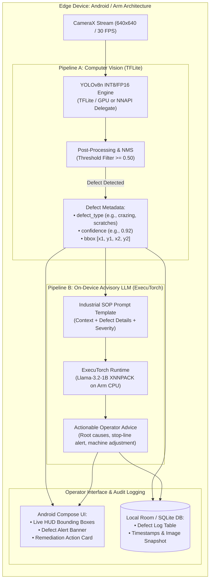

# PROJECT CONTEXT & MASTER TRACKER

**Project Title:** Real-Time Industrial Defect Detection & Quality-Control Assistant  
**Theme:** Manufacturing & Industry 4.0  
**Current Status:** Phase 1 & Phase 2 Active  
**Last Updated:** 2026-11-03  

---

## 1. Core Mission & Technical Constraints

The primary mission is to build a low-latency, fully autonomous, **100% on-device edge quality-control assistant** for factory floor operators. The system detects physical manufacturing surface defects in real time via an edge camera stream and immediately provides actionable, operator-focused remediation guidance without transmitting any telemetry or inference workloads to cloud servers.

### Non-Negotiable Technical Constraints:
1. **Zero Cloud / Zero Network API Dependencies:**
   - All computer vision inferences, LLM token generation, and inspection audit logging must run 100% locally on the device hardware.
   - No external APIs (e.g., OpenAI, Anthropic, HuggingFace Inference API, AWS Rekognition) are permitted.
2. **Dual-Pipeline Edge Architecture:**
   - **Pipeline A (Visual Perception):** High-throughput, low-latency object detection using Ultralytics YOLO (YOLOv8n / YOLOv11n) converted to TensorFlow Lite (`.tflite`) with FP16/INT8 quantization.
   - **Pipeline B (Cognitive Advisory):** Compact Large Language Model (e.g., Llama-3.2-1B-Instruct / Llama-3.2-3B) quantized and executed via PyTorch ExecuTorch using the XNNPACK backend targeting Arm CPU.
3. **Real-Time Edge Budget:**
   - Vision pipeline: Target 15–30 FPS on-device frame processing.
   - LLM pipeline: Target low-latency time-to-first-token (< 1.5s) on mobile Arm CPUs for remediation prompts when a defect is verified.
4. **Local Auditability:**
   - All inspection events, bounding boxes, defect classifications, confidence scores, and remediation recommendations are persisted locally in a Room / SQLite relational database.

---

## 2. Hardware & Team Setup

| Team Member | Hardware Specification | Primary Responsibilities & Deliverables |
| :--- | :--- | :--- |
| **Student 1** | Windows, AMD Ryzen 3, 8GB RAM | **Native Android Application & Edge Integration:** • CameraX real-time preview and image analysis pipeline. • TFLite runtime integration for Pipeline A (bounding box overlays, confidence filtering). • ExecuTorch C++/JNI / Java runtime integration for Pipeline B (advisory LLM). • Local SQLite/Room persistence for inspection event logging and defect history UI. • Operator dashboard UI/UX with remediation action cards. |
| **Student 2** | macOS (Apple Silicon / Intel) | **On-Device LLM & ExecuTorch Optimization:** • ExecuTorch SDK toolchain compilation & setup. • Llama model selection (e.g., Llama-3.2-1B-Instruct) and prompt engineering for industrial SOPs. • Quantization (4-bit / 8-bit using XNNPACK backend optimized for Arm CPU architecture). • Exporting optimized `.pte` binary and tokenizer assets for Student 1. |
| **Student 3** | Windows + Google Colab (Nvidia T4 GPU) | **Computer Vision Defect Detection Pipeline:** • Dataset curation and annotation (NEU Surface Defect / MVTec AD). • Data augmentation, normalization, and YOLO format splitting. • Model training (YOLOv8n/v11n) in Google Colab T4 environment. • Quantization (FP16 / INT8) and `.tflite` model export + validation. • Handover of model metadata, label maps, and quantization scales to Student 1. |

---

## 3. Architecture & Data Flow

### End-to-End Data Flow Steps:
1. **Frame Capture:** CameraX grabs live video frames and feeds RGBA/YUV buffers to the preprocessing pipeline.
2. **Vision Inference:** Preprocessed image tensor (640x640x3) is passed into the quantized `.tflite` YOLO model.
3. **Defect Extraction:** If defect confidence exceeds threshold (e.g., $\ge 0.50$), bounding boxes, class labels, and confidence metrics are generated.
4. **LLM Invocation:** Defect payload is mapped into a strict, structured prompt template (e.g., `[DEFECT: Rolled-in Scale, CONF: 0.89, ZONE: Conveyor-1]`). ExecuTorch generates a concise (2–3 bullet) remediation protocol based on manufacturing Standard Operating Procedures (SOPs).
5. **UI & Storage:** Android HUD draws bounding boxes in real-time, displays the remediation advice card, and records the event snapshot into local SQLite/Room.

---

## 4. Project Roadmap & Active Phase

- [x] **Phase 0: Project Setup & Repository Scaffolding** *(Completed)*
- [ ] **Phase 1: Computer Vision Defect Detection** *(ACTIVE)*
  - [x] Curation pipeline script (`prepare_data.py`): automated acquisition, VOC XML conversion, stratified 80/20 train/val splitting (1,440 train / 360 val images; 4,189 defect boxes across 6 classes), and dynamic `data.yaml` generation. *(Completed)*
  - [x] Colab training notebook (`train_colab.ipynb`): 100% self-contained notebook on T4 GPU for 50 epochs training, mAP@50 quality gate verification, TFLite compilation, and browser download. *(Completed)*
  - [x] Quantization and export script (`export_tflite.py`): FP16 & INT8 quantization, handover bundle generation (`labels.txt`, `model_metadata.json`), and real-image validation inference verification. *(Completed)*
  - [x] Baseline trained NEU-DET checkpoint (`best_neu_yolov8n.pt`) and local verified TFLite model (`defect_yolov8n_fp16.tflite`). *(Completed)*
  - [ ] Colab 50-epoch GPU training run execution by Student 3 (target mAP50 > 0.85).
  - [ ] Final handover bundle delivery to Student 1 for Android CameraX / TFLite runtime integration.
- [ ] **Phase 2: On-Device LLM & ExecuTorch Optimization** *(ACTIVE - Initialized)*
  - [x] Scaffolding `phase2-reasoning/`: structured `prompts/`, `scripts/`, `models/`, and `eval/` subdirectories. *(Completed)*
  - [x] Domain prompt engineering (`qc_system_prompt.py`): telemetry context mapping (`defect_class`, `confidence`, `bbox_area_ratio`, `surface_type`), Llama 3.2 chat template formatting, robust JSON/fallback parsing into `Defect Root Cause`, `Severity Level`, `Actionable Operator Advisory`, and `Immediate Safety Protocol` with stop-line logic. *(Completed)*
  - [x] Toolchain environment validator (`setup_executorch.py`): deep hardware backend, Python runtime, PyTorch export, and XNNPACK/Arm CPU diagnostics with platform-specific setup commands. *(Completed)*
  - [x] Llama 3.2 lowering & quantization pipeline (`export_llama_pte.py`): INT4/INT8/FP16 precision quantization, XNNPACK Arm CPU delegation, mobile runtime memory planning pass (<750MB RAM for INT4), and Android handover metadata generator. *(Completed)*
  - [x] Automated test suite (`eval/test_reasoning_pipeline.py`): 13 passing unit and integration tests across telemetry bounds, prompt generation, parsing fallbacks, diagnostics, and export execution. *(Completed)*
  - [x] Operational playbook (`phase2-reasoning/README.md`) for Student 2 macOS execution. *(Completed)*
  - [ ] Student 2 macOS ExecuTorch toolchain build and full Llama-3.2-1B-Instruct checkpoint download.
  - [ ] Production export of finalized `llama3_2_1b_int4_xnnpack.pte` and tokenizer assets handover to Student 1.
- [ ] **Phase 3: Android Application & Edge Integration**
  - [ ] CameraX pipeline setup with orientation handling and frame analysis.
  - [ ] TensorFlow Lite runtime wrapper with bounding box overlays.
  - [ ] ExecuTorch Android JNI/C++ integration.
  - [ ] Room database schema and DAO for local inspection event logging.
  - [ ] Jetpack Compose Operator HUD with remediation drawer.
- [ ] **Phase 4: End-to-End Testing & Field Evaluation**
  - [ ] Joint testing on physical Android devices.
  - [ ] Thermal, memory, and FPS benchmarking during continuous inspection.
  - [ ] Offline resilience validation (100% disconnected mode).

---

## 5. Ground Rules & Development Principles

1. **Strict Offline Guarantee:** No external network requests, REST calls, or telemetry during inference. Everything runs on edge hardware.
2. **Documentation Ground Truth:** Whenever a milestone, script, or model is updated, the **Changelog** below MUST be updated immediately so all collaborators and AI assistants maintain consistent context.
3. **Artifact Standards:**
   - Vision models must be exported with clean input tensor metadata: `[1, 640, 640, 3]`, normalized appropriately (`0.0` to `1.0` or `0` to `255` uint8).
   - Label indices must be preserved in a standard `labels.txt` or `metadata.json` accompanying every exported model.
4. **Git Hygiene:** Never commit raw dataset zip archives, image sets, or large uncompressed weight files (`.pt`, `.bin`) to version control.

---

## 6. Changelog

| Date | Phase | Author / Agent | Changes Made |
| :--- | :--- | :--- | :--- |
| 2026-11-03 | Phase 1 | Antigravity AI | Project initialization: created `PROJECT_CONTEXT.md`, structured `phase1-vision/` directory, scaffolded dataset preparation scripts, Colab training notebook, TFLite quantization export scripts, and `.gitignore`. |
| 2026-11-03 | Phase 1 | Antigravity AI | Implemented fully automated `prepare_data.py`: automated NEU-DET benchmark acquisition, stream extraction, VOC-to-YOLO normalized annotation parsing, stratified 80/20 train/val partitioning (1,440 train / 360 val images; 4,189 defect boxes), and dynamic `data.yaml` generation. |
| 2026-11-03 | Phase 1 | Antigravity AI | Completed Phase 1 local code deliverables: (1) Verified `export_tflite.py` with real-image inference verification on validation samples (`phase1-vision/data/dataset/images/val/crazing_1.jpg`) and Android handover generation; (2) Built self-contained `train_colab.ipynb` for 50-epoch T4 GPU training, mAP@50 > 0.85 validation, and browser download; (3) Updated `phase1-vision/README.md` with complete Colab instructions; (4) Logged NEU-DET benchmark metrics (1,800 images, 4,189 boxes: crazing 689, inclusion 1011, patches 881, pitted_surface 432, rolled-in_scale 628, scratches 548). |
| 2026-11-03 | Phase 2 | Antigravity AI | Initialized and constructed Phase 2 (Reasoning Pipeline with ExecuTorch & Llama 3.2 1B): (1) Scaffolded `phase2-reasoning/` with `prompts/`, `scripts/`, `models/`, and `eval/`; (2) Engineered `prompts/qc_system_prompt.py` with `DefectContext`, Llama 3.2 chat templates, multi-format parsing, and automated stop-line triggers; (3) Built `scripts/setup_executorch.py` environment validator; (4) Built `scripts/export_llama_pte.py` for INT4/INT8 quantization, XNNPACK backend lowering, mobile runtime memory planning (<750MB budget), and Android handover metadata generation; (5) Built and executed 13-test suite in `eval/test_reasoning_pipeline.py` (100% passing); (6) Authored `phase2-reasoning/README.md` operational guide. |
