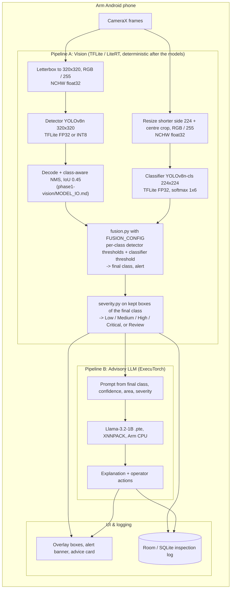

# PROJECT CONTEXT & MASTER TRACKER

**Project Title:** Real-Time Industrial Defect Detection & Quality-Control Assistant  
**App name:** AANetra (A, A, N team initials + "netra" = eye). Use **AANetra** as the Android app display name in Phase 3.  
**Tagline:** On-device steel defect inspection.  
**Theme:** Manufacturing & Industry 4.0 (Bharat AI-SoC Challenge 2026–27, PS5)  
**Target device:** Arm Android phone (TFLite for vision, ExecuTorch for the Llama advisor)  
**Current Status:** Phase 1 (vision) COMPLETE. **Phase 1.1 (near-zero image-level error) COMPLETE: fused 270/270 on the test set (lab images, defect-free parts unmeasured).** **Phase 1.2 (reject non-steel photos, `not_steel` class) PLANNED: code ready, Colab run pending.** Phase 2 (advisory LLM) NEXT. Phase 3 NOT STARTED.  
**Last Updated:** 2026-11-08  

> Honesty rule for this file: only mark something done when it has been run and the
> result is in the repo (or a linked Drive folder). Estimates are labelled as estimates.

---

## 1. Core Mission & Technical Constraints

Build a low-latency, **100% on-device** quality-control assistant for factory-floor operators. It detects surface defects from a camera stream and gives operator guidance. No inference or telemetry goes to the cloud.

### Non-Negotiable Technical Constraints
1. **Zero cloud / zero network APIs at runtime.** Vision inference, LLM generation and logging all run on the device. No third-party cloud AI APIs (e.g. OpenAI, HF Inference API). (The only network use is the one-time dataset download during training.)
2. **Two separate pipelines:**
   - **Pipeline A (vision), all TensorFlow Lite (LiteRT), all deterministic after the models:**
     detector **YOLOv8n** (320x320, TFLite FP32 or INT8) + image classifier **YOLOv8n-cls**
     (224x224, TFLite FP32; no INT8 classifier, its export hung) -> **`phase1-vision/fusion.py`**
     (`FUSION_CONFIG`: per-class detector thresholds, classifier threshold -> final class + alert)
     -> **`phase1-vision/severity.py`** (area / count rule on the kept boxes of the final class ->
     Low / Medium / High / Critical, or "Review" when there is an alert but no box). Both models
     come from Phase 1.1 (run `p11_split701515_det320_cls224_s42`).
   - **Pipeline B (advisory):** Llama-3.2-1B-Instruct exported to an ExecuTorch `.pte` (XNNPACK, Arm CPU).
     It only receives Pipeline A's result; it never feeds back into it.
   - **Class, alert and severity are decided by deterministic code from vision output** (`fusion.py` +
     `severity.py`). The LLM explains the result and suggests actions. It never decides class or severity.
3. **Real-time targets (goals, nothing measured yet):** vision 15–30 FPS on the phone; LLM time-to-first-token < 1.5 s.
4. **Local auditability:** inspection events are logged on the device (Room/SQLite, Phase 3).

---

## 2. Hardware & Team Setup

| Team Member | Hardware | Responsibilities |
| :--- | :--- | :--- |
| **Student 1** | Windows, AMD Ryzen 3, 8 GB RAM | Phase 3: Android app (CameraX, TFLite runtime, ExecuTorch runtime, Room logging, UI, benchmarks). |
| **Student 2** | macOS | Phase 2: Llama-3.2-1B → ExecuTorch `.pte` export, prompt/parser, on-device LLM runtime. |
| **Student 3** | Windows + Google Colab GPU | Phase 1 / 1.1: dataset, YOLOv8n detector + YOLOv8n-cls classifier training, evaluation, TFLite export, fusion + severity rules, I/O contract for Student 1. |

---

## 3. Architecture & Data Flow (planned design, Phase 3 not built)

**Which thresholds the app uses (checked in the code, `phase1-vision/fusion.py`):**
- **In the app, the detector per-class confidence thresholds come from `FUSION_CONFIG`**
  (`det_class_min_confidence`: crazing 0.10, inclusion 0.50, patches 0.55, pitted_surface 0.15,
  rolled-in_scale 0.15, scratches 0.30; `det_min_confidence` 0.50 for any other class), together with
  the classifier threshold `cls_threshold` 0.64. `fuse()` keeps the detections at or above these.
- `fuse()` then calls `severity.assess_severity()` on the kept boxes of the final class, with
  `FUSION_CONFIG["severity"]` (a copy of `SEVERITY_CONFIG`) in which `_severity_config()` **replaces**
  `min_confidence` and `class_min_confidence` by the `FUSION_CONFIG` detector thresholds. Its
  confidence filter therefore drops nothing (every box passed it already); `fuse()` asserts that the
  severity defect count equals the number of kept boxes. From `severity.py` the app uses only the
  area cutoffs (0.082 / 0.184 / 0.359), the count escalation (3+ boxes) and the per-class area
  weights (all 1.0).
- **`SEVERITY_CONFIG`'s own min confidences (crazing 0.25, others 0.50) are used only in the Phase 1
  standalone path**: `assess_severity()` called directly, as in `scripts/check_models.py`, the Phase 1
  notebook `train_colab.ipynb` and `tests/test_severity.py`. The app must not apply them on top of
  `FUSION_CONFIG`.
- The detector decode itself (MODEL_IO.md) keeps every box with confidence >= 0.05 (any value at or
  below the lowest `FUSION_CONFIG` threshold, 0.10, gives the same result) before class-aware NMS;
  `fuse()` applies the real thresholds afterwards.

NNAPI is deprecated on recent Android, so use the GPU delegate or XNNPACK.

---

## 4. The 3-phase plan

| Phase | Scope | Output | Status |
| :--- | :--- | :--- | :--- |
| **Phase 1: Vision model** | NEU-DET → YOLOv8n trained in Colab → evaluation → severity rule → TFLite FP32 + INT8 export → sanity check → I/O documentation | `.tflite` x2, `labels.txt`, `MODEL_IO.md`, results JSON + plots, notebook, `requirements.txt` | **COMPLETE** (2026-11-07) |
| **Phase 1.1: Image-level accuracy** | 70/15/15 split, detector retrain, YOLOv8n-cls image classifier, deterministic fusion rule, thresholds on val, all numbers on test | `.tflite` x3 (detector FP32 + INT8, classifier FP32; classifier INT8 skipped), `fusion.py`, `fusion_config.json`, `phase1_1_results.json` | **COMPLETE** (2026-11-08) |
| **Phase 1.2: Reject non-steel photos** | 7th classifier class `not_steel` (COCO / DTD / Places365, ~2,000 images), detector unchanged, RETAKE rule first in `fusion.py`, t_ns on val (steel false rejection <= 1 %), numbers on test | classifier v2 FP32 `.tflite` `[1, 7]`, `fusion_config.json`, `phase1_2_results.json` | **PLANNED** (code ready, Colab run pending) |
| **Phase 2: Advisory LLM** | Llama-3.2-1B-Instruct → ExecuTorch `.pte` (XNNPACK, 8da4w quantisation) + tokenizer, prompt/parser fixes, runtime on Arm | real `.pte`, tokenizer, measured TTFT and tokens/s | **NEXT** (not started) |
| **Phase 3: Android app** | CameraX + TFLite + ExecuTorch, alerting UI, Room logging, on-device benchmarks, deliverables (README, report, demo video) | APK, benchmark results, report, video | **NOT STARTED** |

### Phase 1 tracker (COMPLETE, 2026-11-07)

Source of every number: `phase1-vision/results/phase1_results.json` from the Colab run of commit `25551ad`
(Tesla T4, Ultralytics 8.4.198, torch 2.14.1, Python 3.13). Run name `neu_yolov8n_320_e100_s42`.
**Models are on Google Drive under `MyDrive/qc-defect-detector/phase1/neu_yolov8n_320_e100_s42/models/`, not in git**
(`best.pt`, `defect_yolov8n_320_{fp32,int8}.tflite`, `labels.txt`, `model_io.json`).

| # | Step | Status | Evidence / notes |
| :--- | :--- | :--- | :--- |
| 1 | Dataset ready | ✅ Done | Real NEU-DET, `prepare_data.py` seed 42: **1,440 train / 360 val**, 0 train/val overlap (checked in memory and on disk, also in Colab). `data.yaml` has no absolute path. |
| 2 | Trained in Colab | ✅ Done | YOLOv8n from COCO-pretrained weights, imgsz 320, batch 32, seed 42, **100/100 epochs** (patience 30), **15.6 min** on a T4. Curves: `results/results.png`, `results/results.csv`. |
| 3 | Evaluation | ✅ Done | `best.pt` on val: **mAP50 0.769, mAP50-95 0.446**, P 0.714, R 0.736 (Ultralytics default val = 352 px input; **at the deployed 320 px input: 0.744 / 0.420**, see step 6). Per-class mAP50: crazing **0.406**, inclusion 0.856, patches 0.925, pitted_surface 0.850, rolled-in_scale **0.652**, scratches 0.927. **Weak classes: crazing** (R 0.34, mAP50-95 0.149) and **rolled-in_scale** (mAP50-95 0.307). Confusion matrices and PR/P/R/F1 curves in `results/`. |
| 4 | Severity rule | ✅ Done | `phase1-vision/severity.py`, 30 unit tests passing. Per-class min confidence: **crazing 0.25**, all others 0.50. Chosen from the 360-image val sweep (`results/phase1_checks.json` -> `pr_sweep`): crazing images flagged FP32 56/60, INT8 51/60 (vs 25/60, 21/60 at 0.50); box precision at 0.25 (FP32 0.42, INT8 0.49) is no worse than at 0.30; 0 crazing detections on the 300 non-crazing images at any threshold down to 0.10. 0.30 was rejected because INT8 scores `crazing_90.jpg` at 0.299. **Area thresholds tuned from data:** `scripts/tune_severity.py` takes the 866 val ground-truth boxes and sets Low/Medium/High cutoffs at their p40/p70/p90 area ratio: **0.082 / 0.184 / 0.359** (was 0.02 / 0.05 / 0.10, a guess under which 8 of 10 demo images were Critical). GT boxes then split 40 / 30 / 20 / 10 %. Per class it is uneven (pitted_surface boxes are big: 73 % Critical; inclusion small: 75 % Low) because the rule is class-neutral. On all 360 val images (conf 0.25 detections) the FP32 detection levels are Low 41.8 / Medium 30.1 / High 17.3 / Critical 10.7 %; image levels (worst detection, then the 3+ escalation) are **FP32: Low 31, Medium 98, High 90, Critical 116, none 25** (90 escalated); **INT8: 33 / 89 / 92 / 115, none 31**. Image levels lean to High/Critical because one image takes its worst box and many NEU images have 3+ defects. `results/severity_demo.png` regenerated (FP32 + INT8). **Tuned on NEU 200x200 crops: must be re-tuned on real camera images in Phase 3.** The Phase 2 prompt (`qc_system_prompt.py`) still has the old 0.02 / 0.10 numbers. |
| 5 | TFLite export FP32 + INT8 | ✅ Done | `export_tflite.py` in Colab. **FP32 12.69 MB, INT8 3.44 MB** (INT8 calibrated on 30 % of train, float32 I/O). Both asserted `[1, 10, 2100]`. |
| 6 | TFLite sanity check | ✅ Done | Val mAP50 / mAP50-95 at 320 px: **`.pt` 0.744 / 0.420 = FP32 0.744 / 0.420**, INT8 0.715 / 0.372 locally (0.707 / 0.367 in Colab; quantised kernels differ by CPU). **The `.pt` -> FP32 gap was the val input size** (352 px rect for `.pt`, fixed 320 for TFLite), not conversion loss. Full val (360 images, conf 0.25) vs `.pt`: **FP32 949/949 detections matched (100 %), 360/360 images identical; INT8 868/949 (91.5 %), 268/360 images identical**, mean IoU 0.907. **Image-level accuracy** (>= 1 kept detection of the image's class): **FP32 334/360 = 92.8 %, INT8 327/360 = 90.8 %**; per class FP32 / INT8: crazing 93 / 85 %, inclusion 100 / 98 %, patches 100 / 100 %, pitted_surface 92 / 88 %, rolled-in_scale 73 / 75 %, scratches 98 / 98 %. Misses are nearly all "no detection kept" (FP32 25, INT8 31), only 1 / 2 wrong-class. Source: `scripts/check_models.py` -> `results/phase1_checks.json`. |
| 7 | I/O format documented | ✅ Done | `phase1-vision/MODEL_IO.md`, all values confirmed on the exported files, plus SHA-256 of every model file: input NCHW float32 `[1,3,320,320]` in 0–1, output float32 `[1,10,2100]`, boxes normalised xywh (max abs 1.01), sigmoid class scores, no NMS. |
| 8 | Notebook / results / requirements in repo | ✅ Done | Notebook, pinned `requirements.txt`, and `phase1-vision/results/` (JSON, CSV, PNGs; no model files) committed. |

### Phase 1.1 tracker (COMPLETE, 2026-11-08): near-zero image-level error

Goal: the operator-facing answer per image (defect class + alert) is almost never wrong. Phase 1 got
92.8 % (FP32) / 90.8 % (INT8) image-level accuracy on val, nearly all misses being "no detection kept".
Phase 1.1 adds an image classifier and a fusion rule, and moves to a train/val/test split so that
thresholds are tuned on val and every reported number comes from the untouched test set.

Source of every number: `phase1-vision/results/phase1_1/phase1_1_results.json` (plus `fusion_config.json`
and plots in the same folder) from the Colab run `p11_split701515_det320_cls224_s42` (Tesla T4,
Ultralytics 8.4.198, notebook `train_colab_phase1_1.ipynb` at commit `e48df70`, resumed from the Drive
backup `p11_backup` after the classifier INT8 export hung). **Models are on Google Drive under
`MyDrive/qc-defect-detector/phase1/p11_split701515_det320_cls224_s42/models/` and locally in
`phase1-vision/models/exported/phase1_1/{detector,classifier}/` (gitignored), not in git**
(`models/detector/`: `best_..._detector.pt`, `defect_yolov8n_320_{fp32,int8}.tflite`, `labels.txt`, `model_io.json`;
`models/classifier/`: `best_..._classifier.pt`, `defect_cls_yolov8n_224_fp32.tflite`, `labels.txt`, `model_io.json`).
The Phase 1 Drive folder `neu_yolov8n_320_e100_s42` and the backup were checked unchanged.
SHA-256 and size of every model file: `phase1-vision/MODEL_IO.md` -> *Phase 1.1 model files*.

> **Phase 3 must use these Phase 1.1 models** (detector FP32 or INT8 + classifier FP32, with
> `fusion.py` / `FUSION_CONFIG`), not the Phase 1 models of run `neu_yolov8n_320_e100_s42`.

| # | Step | Status | Evidence / notes |
| :--- | :--- | :--- | :--- |
| 1 | 70/15/15 split | ✅ Done | `prepare_data.py` default `--split 70/15/15`, seed 42: **1,260 train / 270 val / 270 test** = **210 / 45 / 45 per class** (boxes 2,899 / 661 / 629), pairwise overlap 0 (in memory, on disk, and asserted in Colab). `data.yaml` has `test: images/test`. `--split 80/20` reproduces the Phase 1 split exactly. Classifier copy of the same split: `build_cls_dataset.py` -> `data/cls/{train,val,test}/<class>/`. |
| 2 | Detector retrain | ✅ Done | YOLOv8n (COCO-pretrained), imgsz 320, batch 32, seed 42, **100/100 epochs**. Exported FP32 (12,693,227 bytes) and INT8 (3,441,424 bytes, calibrated on 30 % of train). **TEST mAP50 / mAP50-95 at 320 px: `.pt` 0.741 / 0.413 = FP32 0.741 / 0.413, INT8 0.693 / 0.340.** |
| 3 | Image classifier | ✅ Done (FP32); **INT8 skipped** | YOLOv8n-cls (ImageNet-pretrained), imgsz 224, patience 20, seed 42; early-stopped after **34 epochs**. FP32 `.tflite` 5,815,905 bytes, input NCHW float32 `[1,3,224,224]` 0..1 (mean 0, std 1), output float32 `[1,6]` softmax. **TEST top-1: `.pt` 269/270 = FP32 269/270 (99.6 %)**, FP32 same top-1 as `.pt` on 270/270; the one error is a rolled-in_scale image called crazing. Reference pre-processing matches the `.pt` pipeline to 5.8e-6 on all 540 val + test images. **Classifier INT8 was skipped:** the export hung (49 min, no output, no file activity) in the ai-edge-quantizer calibration step and was interrupted; `model_io.json` records `status: skipped` with the reason and timestamp. Every export precision now runs in a child process with a timeout (`scripts/export_child.py`, default 15 min); skipping classifier INT8 needs `--allow-skip-int8`. The **INT8 pipeline = detector INT8 + classifier FP32**. |
| 4 | Fusion rule | ✅ Done | `phase1-vision/fusion.py`: final_class = classifier if conf >= `cls_threshold`, else top kept detection, else "no defect found"; alert = kept detection OR confident classifier; severity = `severity.py` on the kept boxes of final_class, or **"Review"** when there is an alert but no such box. Unit tests cover every branch and pin `FUSION_CONFIG` to `fusion_config.json`. |
| 5 | Threshold selection (val only) | ✅ Done | `scripts/fusion_eval.py` on the 270 val images, FP32 + INT8 pipelines summed: **classifier 0.64**; detector per class **crazing 0.10, inclusion 0.50, patches 0.55, pitted_surface 0.15, rolled-in_scale 0.15, scratches 0.30**. Now in `FUSION_CONFIG`. Val fused: 270/270 for both pipelines. |
| 6 | Test-set evaluation | ✅ Done | 270 test images, never used for training or thresholds. **Fused image-level accuracy: 270/270 (100 %) for the FP32 pipeline and 270/270 for the INT8 pipeline (detector INT8 + classifier FP32)**; classifier decided 267 images, detector 3; "Review" level 0 (FP32) / 5 (INT8 pipeline). For comparison: **classifier alone 269/270**, **detector alone 267/270 (FP32) and 256/270 (INT8)** (INT8 misses: 5 patches with no box kept, pitted_surface called patches, scratches called inclusion). Severity levels (FP32 pipeline): Low 18, Medium 59, High 73, Critical 120. Plots: `cls_confusion_test.png`, `image_accuracy_test.png`, detector/classifier training curves. |

**Caveats (read before quoting 270/270):**
- **No defect-free images.** NEU-DET has a defect in every image, so "alert" is always right here and
  false alarms on good parts are **not measured at all**. 270/270 says the defect *class* is right, not
  that good parts would pass.
- **Detector thresholds are low because of that** (crazing 0.10, pitted_surface and rolled-in_scale 0.15):
  the val sweep never pays for a false alarm on a clean part. They **must be re-tuned with clean-part
  images in Phase 3**, and the classifier threshold (0.64) checked on them too.
- **Lab images only:** 200x200 grayscale NEU crops. Expect lower accuracy on phone-camera frames
  (lighting, blur, scale, other steel surfaces) until re-validated on real camera data.
- 270 test images (45 per class) is small: one error is 0.4 %. Per-class 45/45 does not prove a 0 % error rate.
- **Severity cutoffs saw the test images.** The severity area thresholds (0.082 / 0.184 / 0.359) were
  tuned on the ground-truth boxes of the Phase 1 (80/20) val set. With the same seed, **all 270
  Phase 1.1 test images are in that Phase 1 val set** (the other 90 are now Phase 1.1 val; checked by
  file name). This affects only the reported severity distribution on test (Low 18 / Medium 59 /
  High 73 / Critical 120), **not** class accuracy, alerts or detector/classifier numbers: the cutoffs
  are percentiles of box area and play no part in choosing the class. Re-tune severity on Phase 3
  camera images anyway (see *Carried over to Phase 3*).

### Phase 1.2 tracker (PLANNED, Colab run pending): reject non-steel photos

Goal: a photo that is not a steel surface (people, fields, ground, walls, boards, objects) gets
`"not a steel surface"` + decision **RETAKE** instead of a defect class. The detector is the Phase 1.1
detector, unchanged. Run folder: Drive `p12_cls7_notsteel_s42` (Phase 1 and Phase 1.1 folders read only).
Notebook `phase1-vision/notebooks/train_colab_phase1_2.ipynb`, data sources and licences in
`phase1-vision/DATA_SOURCES.md`.

| # | Step | Status | Evidence / notes |
| :--- | :--- | :--- | :--- |
| 1 | Steel split identical to Phase 1.1 | ⏳ Pending (code ready) | NEU 70/15/15 seed 42; file lists pinned in `results/phase1_2/neu_split_manifest_s42.json` (1,260 / 270 / 270), asserted in Colab. |
| 2 | not_steel data | ⏳ Pending (code ready) | `scripts/build_not_steel.py`: COCO val2017 1,000 + DTD 600 (all 47 categories) + Places365 val 400 (fields / roads / buildings); ~50 % grayscale, ~50 % random crop to 200x200; 70/15/15 per source -> 1,400 / 300 / 300, zero overlap by id and content hash. URLs checked (HTTP 200) on 2026-11-21. |
| 3 | Classifier v2 (7 classes) | ⏳ Pending | YOLOv8n-cls from `yolov8n-cls.pt`, imgsz 224, patience 20, seed 42; head reordered to NEU classes then `not_steel` (`scripts/reorder_cls_classes.py`). |
| 4 | FP32 TFLite export | ⏳ Pending | `export_cls_tflite.py --num-classes 7 --precisions fp32 --allow-skip-int8`: output asserted `[1, 7]`, INT8 not attempted (recorded as skipped). |
| 5 | Fusion RETAKE rule | ✅ Code done | `fusion.py`: not_steel top-1 with p >= `not_steel_threshold` -> "not a steel surface", alert False, no severity, decision RETAKE, detector ignored. Placeholder t_ns 0.50 until step 6. Unit tests in `tests/test_phase1_2.py`. |
| 6 | Thresholds (val only) | ⏳ Pending | t_ns: most not_steel rejected with steel false rejection <= 1 %; classifier threshold 0.64 re-checked. |
| 7 | Test report | ⏳ Pending | 7x7 confusion, steel fused accuracy with the Phase 1.1 detector (target ~270/270), not_steel rejection rate, steel false-rejection rate. |

### Phase 2 status: NEXT (not started)

- **No Llama model has been exported.** `phase2-reasoning/models/llama3_2_1b_int4_xnnpack.pte` (local, gitignored) is a **1 KB placeholder** (`ET01` header + repeated `AA BB CC DD`) written by the script's simulation path. `phase2-reasoning/models/llama_pte_metadata.json` describes that placeholder, not a real model.
- `export_llama_pte.py` does not load Llama weights, does not quantise, and reports success even when it only simulates. Its memory figure ("< 750 MB") is a formula output, not a measurement. A real 1B 8da4w `.pte` is about 1 GB.
- The 13 tests in `phase2-reasoning/eval/` pass, but they only test string handling and the placeholder file. They do not test any real model.
- `prompts/qc_system_prompt.py` (prompt builder and parser) exists. Its severity logic disagrees with `phase1-vision/severity.py` and will be fixed in Phase 2.

### Phase 3 status: NOT STARTED
No Android code, logging, UI or benchmarks exist yet.
- App display name (launcher label, `app_name`): **AANetra**. Tagline: "On-device steel defect inspection."

---

## 5. Ground Rules & Development Principles

1. **Strict offline guarantee** at runtime.
2. **Documentation ground truth:** update the Phase 1 tracker and the Changelog whenever something is run or changed. Never mark a step done without evidence.
3. **No silent fallbacks:** scripts must raise when a model, file or step is missing. They must never substitute a different model (e.g. COCO `yolov8n.pt`) or a cached file.
4. **Artifact standards:**
   - Every exported vision model ships with `labels.txt` and `model_io.json`. The input/output contract lives in `phase1-vision/MODEL_IO.md`, and must be filled from the real exported file, never assumed.
   - Class order: `crazing, inclusion, patches, pitted_surface, rolled-in_scale, scratches`.
5. **Portability:** no absolute or OS-specific paths in committed files. Scripts resolve paths from their own location.
6. **Git hygiene:** never commit datasets, `.pt`, `.tflite`, `.pte` or `.bin`. Share models via Drive or a GitHub Release.

---

## 6. Carried over to Phase 3

Open items from Phase 1 / 1.1 that the Android work (Phase 3) must close. None of them is done.

| # | Item | Why / what to do |
| :--- | :--- | :--- |
| 1 | **Defect-free images + threshold re-tuning** | NEU-DET has no good parts, so false alarms are unmeasured and the detector thresholds in `FUSION_CONFIG` are low (crazing 0.10, pitted_surface / rolled-in_scale 0.15). Collect clean-part images from the target camera and setup, measure the false-alarm rate, and re-tune `det_class_min_confidence` and `cls_threshold` on a val set that contains good parts (same sweep code, `scripts/fusion_eval.py`, with a cost for false alarms). |
| 2 | **Real camera test** | All accuracy numbers are on 200x200 grayscale NEU lab crops. Test the full Pipeline A on phone-camera frames of real parts (lighting, blur, scale, other steel surfaces) and report image-level accuracy and false alarms. |
| 3 | **Severity re-tuning** | Area cutoffs 0.082 / 0.184 / 0.359 are percentiles of NEU val boxes (and that val set contains the Phase 1.1 test images). Re-derive them on camera images (`scripts/tune_severity.py` method) and, ideally, with a process engineer's per-class weights. |
| 4 | **NCHW input pre-processing in the app** | Both TFLite models take **NCHW float32** (`[1,3,320,320]` detector, `[1,3,224,224]` classifier), RGB / 255, no mean/std. Detector: letterbox (pad 114). Classifier: shorter side -> 224, centre crop. Write `buffer[c*H*W + y*W + x]`. Verify the Kotlin pre-processing against `scripts/tflite_utils.py` on the same images (outputs must match). |
| 5 | **Phone benchmarks** | Measure on the target phone: FPS and per-frame latency of detector + classifier + fusion (FP32 vs INT8 detector, XNNPACK vs GPU delegate), LLM time-to-first-token and tokens/s, peak RAM of the app. Targets in Section 1 are goals only until then. |

---

## 7. Before submission (23 Nov 2026)

Checklist for the Bharat AI-SoC Challenge submission. None of it is done yet.

| # | Item | Notes |
| :--- | :--- | :--- |
| 1 | **GitHub Release with the models + hashes** | Attach the Phase 1.1 detector (`defect_yolov8n_320_{fp32,int8}.tflite`), classifier (`defect_cls_yolov8n_224_fp32.tflite`), `labels.txt`, both `model_io.json`, and the Llama `.pte` + tokenizer if the licence allows redistribution; list SHA-256 + size of each file (Phase 1.1 values in `phase1-vision/MODEL_IO.md`). Models are not in git. |
| 2 | **Root README** | What the project is, architecture (Pipelines A and B), how to build/run the app and reproduce training, results with caveats, links to the Release and docs. |
| 3 | **LICENSE** | Choose and add a licence for the project code; check it is compatible with Ultralytics (AGPL-3.0) and the other dependencies. |
| 4 | **NEU-DET citation** | Cite the dataset (K. Song, Y. Yan, 2013; Y. He et al., IEEE TIM 2020; see `phase1-vision/README.md`) in the README and the report. |
| 5 | **Llama 3.2 licence notice / "Built with Llama"** | Include the Llama 3.2 Community License notice and the "Built with Llama" attribution required by Meta's licence in the README, the app (about screen) and the report. |
| 6 | **Repo access for judges** | Make the repository public, or give the judges access; check that the Release assets download without login. |
| 7 | **Report** | Design, both pipelines, results on the test set with all caveats (no defect-free images, lab images only, severity tuning overlap), phone benchmarks. |
| 8 | **Demo video** | The app running on the phone: live detection, alert, severity, LLM advice, inspection log. |

---

## 8. Changelog

| Date | Phase | Author / Agent | Changes Made |
| :--- | :--- | :--- | :--- |
| 2026-11-03 | Phase 0/1 | Student 3 | Initial scaffolding: `PROJECT_CONTEXT.md`, `phase1-vision/` layout, `prepare_data.py`, Colab notebook, `export_tflite.py`, `.gitignore`. (Later found: the split leaked 5 images across train/val, `data.yaml` had an absolute Windows path, and the exported `.tflite` files were COCO yolov8n, not the defect model. See 2026-11-07.) |
| 2026-11-03 | Phase 2 | Student 3 | Scaffolded `phase2-reasoning/`: prompt builder/parser, `setup_executorch.py`, `export_llama_pte.py` (simulation only, no real Llama export), 13 string-level tests. |
| 2026-11-07 | All | Audit | `AUDIT_REPORT.md`: the Llama `.pte` is a placeholder; both `.tflite` files are COCO (output `[1,84,8400]`); split overlap; Windows path in `data.yaml`; several false claims in this file. |
| 2026-11-07 | Phase 1 | Student 3 | Phase 1 fixes (audit C3, C4, C6-vision, I6, I9, part of I1, C9). `prepare_data.py`: clears output dirs, private seeded RNG, fails on any train/val overlap (in memory and on disk), prints final counts, synthetic data only with `--synthetic`, CWD-independent defaults. `data.yaml`: no absolute path. `export_tflite.py` rewritten: no COCO or cached-TFLite fallbacks, FP32 + INT8 (train-calibrated) via Ultralytics LiteRT, asserts `[1,10,N]`, prints the real input shape/layout/dtype, writes `model_io.json`. New `scripts/tflite_utils.py` (reference decoder), `severity.py` (deterministic rule) and `tests/` (28 tests). New `requirements.txt` (pinned), `MODEL_IO.md`. Colab notebook rewritten end to end (clone → pinned install → NEU-DET → train imgsz 320 → val → export → .pt vs TFLite comparison → TFLite mAP → severity demo → Drive). Deleted the stray root `yolov8n.pt` / `yolov8n.onnx` and the wrong COCO `.tflite` + `model_metadata.json`. Removed the false claims from this file and added the 3-phase plan and the Phase 1 tracker. |
| 2026-11-07 | Phase 1 | Student 3 | **Phase 1 complete.** Colab run of `25551ad` (T4, 100 epochs, 15.6 min): `best.pt` val mAP50 0.769 / mAP50-95 0.446; FP32 TFLite 0.744 / 0.420 (12.69 MB); INT8 TFLite 0.707 / 0.367 (3.44 MB); 10-image match vs `.pt` 100 % (FP32) / 92 % (INT8). Weak classes: crazing, rolled-in_scale. `MODEL_IO.md` filled with the confirmed values (NCHW float32 input, `[1,10,2100]` output, normalised boxes). `severity.py`: per-class min confidence (crazing 0.30, others 0.50), 7 new tests (35 total pass). Committed `phase1-vision/results/` (JSON, CSV, PNGs). Models stay on Google Drive. |
| 2026-11-07 | Phase 1 | Student 3 | Post-run checks with the Drive models (new `scripts/check_models.py`, runs on Windows CPU; output `results/phase1_checks.json`). SHA-256 of all 5 model files in `MODEL_IO.md`. Full-val `.pt` vs TFLite: FP32 100 % (949/949), INT8 91.5 % (868/949). `.pt` -> FP32 mAP gap explained: Ultralytics evaluates `.pt` at 352 px (rect), TFLite at 320; at 320 the `.pt` equals FP32 (0.744 / 0.420). Crazing min confidence 0.30 -> **0.25** from the P/R sweep (0.30 dropped `crazing_90.jpg` on INT8). `severity_demo.png` regenerated with the current rule for FP32 and INT8. 36 tests pass. `.gitignore`: Ultralytics label cache. |
| 2026-11-07 | Phase 1 | Student 3 | Severity area thresholds tuned from data: new `scripts/tune_severity.py` (p40/p70/p90 of the 866 val GT box area ratios -> `results/severity_thresholds.json`): 0.02 / 0.05 / 0.10 -> **0.082 / 0.184 / 0.359**. Tests updated (37 pass). `check_models.py` now also reports the severity level distribution and image-level accuracy on all 360 val images (FP32 92.8 %, INT8 90.8 %); `severity_demo.png` regenerated. Tuned on NEU crops only: re-tune on camera images in Phase 3. |
| 2026-11-07 | Phase 1.1 | Student 3 | Code for Phase 1.1 (no training run yet). `prepare_data.py`: stratified 70/15/15 default (210/45/45 per class, seed 42), pairwise overlap check, `test:` in `data.yaml`, `--split 80/20` keeps the old split byte-for-byte. New `scripts/build_cls_dataset.py` (ImageFolder from the same split), `scripts/export_cls_tflite.py` (classifier FP32/INT8, `[1, 6]` + softmax asserts), classifier helpers in `tflite_utils.py`, `scripts/fusion_eval.py` (val sweep + image-level evaluation), `fusion.py` (deterministic fusion rule), new notebook `train_colab_phase1_1.ipynb`. Tests: 81 pass (30 fusion, 14 tooling). `MODEL_IO.md` classifier section (TODO values), README. |
| 2026-11-07 | Phase 1.1 | Student 3 | Colab run: both models trained; classifier INT8 export hung in ai-edge-quantizer calibration (49 min, interrupted); everything backed up to Drive `p11_backup/`. New `scripts/export_child.py`: each precision exported in a child process with a timeout (default 15 min, `--timeout-min`) that kills the process tree. `export_tflite.py`: any failure is a hard error. `export_cls_tflite.py`: FP32 failure is a hard error; INT8 failure is recorded as skipped only with `--allow-skip-int8` (loud warning); new `--reuse-existing` to rebuild `model_io.json` from existing files. Notebook: `RESUME_FROM_DRIVE` (default the backup; skips training and export, copies `runs/` + `export/`, checks the backup unchanged), all later cells driven by the precisions in `model_io.json`, INT8 pipeline labelled detector INT8 + classifier FP32. Fixed `classifier_only_accuracy` missing per-class accuracy (would have crashed the plot cell). 106 tests pass. |
| 2026-11-08 | Phase 1.1 | Student 3 | **Phase 1.1 complete.** Results of run `p11_split701515_det320_cls224_s42` committed to `phase1-vision/results/phase1_1/`. TEST: fused 270/270 (FP32 pipeline and INT8 pipeline = detector INT8 + classifier FP32), classifier 269/270, detector-only 267/270 (FP32) / 256/270 (INT8), detector mAP50 0.741 (FP32) / 0.693 (INT8). Val-chosen thresholds put in `FUSION_CONFIG` (classifier 0.64; detector crazing 0.10, inclusion 0.50, patches 0.55, pitted_surface 0.15, rolled-in_scale 0.15, scratches 0.30); tests pin them to `fusion_config.json`. `MODEL_IO.md` classifier section filled (INT8 skipped). Caveats: no defect-free images, low detector thresholds to re-tune in Phase 3, lab images only. SHA-256 + size of every file in `models/exported/phase1_1/` added to `MODEL_IO.md`; these Phase 1.1 models are marked as the ones Phase 3 must use. |
| 2026-11-08 | All | Student 3 | `PROJECT_CONTEXT.md`: Pipeline A in Section 1 and the Section 3 diagram now = detector YOLOv8n (TFLite FP32/INT8) + classifier YOLOv8n-cls (TFLite FP32) -> `fusion.py` (`FUSION_CONFIG`) -> `severity.py`, Pipeline B separate; documented from the code that the app's detector thresholds come from `FUSION_CONFIG` and `SEVERITY_CONFIG` min confidences apply only to the Phase 1 standalone path; new sections *Carried over to Phase 3* and *Before submission (23 Nov 2026)*; caveat that all 270 Phase 1.1 test images were in the Phase 1 val set used to tune the severity cutoffs; changelog sorted oldest first, authors renamed. |
| 2026-11-08 | Phase 1 | Student 3 | Local offline demo: `phase1-vision/demo/` (`app.py` Gradio UI, `predict.py` CLI, shared `pipeline.py`), `requirements-demo.txt`, `tests/test_demo.py`, 12 TEST-split examples. TFLite only, via `tflite_utils.py`, `fusion.py` and `severity.py`, decoded at conf 0.05 / NMS 0.45 like the Phase 1.1 evaluation. On all 270 TEST images on Windows CPU it reproduces the committed results: fused 270/270 for both pipelines, same severity distributions, Review 0 (FP32) / 5 (INT8). Median invoke: detector 37 ms FP32 / 29 ms INT8, classifier 9 ms (laptop, not phone). |
| 2026-11-20 | Phase 3 | Team | App name recorded: **AANetra** (A, A, N team initials + "netra" = eye), tagline "On-device steel defect inspection". AANetra is the Android app display name in Phase 3. |
| 2026-11-21 | Phase 1.2 | Student 3 | Code for Phase 1.2 (no Colab run yet): 7th classifier class `not_steel`. `fusion.py`: not_steel RETAKE gate checked first (`not_steel_threshold` placeholder 0.50, `decision` field, `CLS7_CLASSES`, `classifier_classes`); `fusion_eval.py`: 7-class records, `retake` count, `choose_not_steel_threshold`; `export_cls_tflite.py --num-classes 7`, FP32-only export records INT8 as skipped; new `scripts/build_not_steel.py`, `scripts/reorder_cls_classes.py`, notebook `train_colab_phase1_2.ipynb`, `DATA_SOURCES.md`, NEU split manifest. `MODEL_IO.md` classifier v2 section (TODO values). Tests: 161 pass. |
