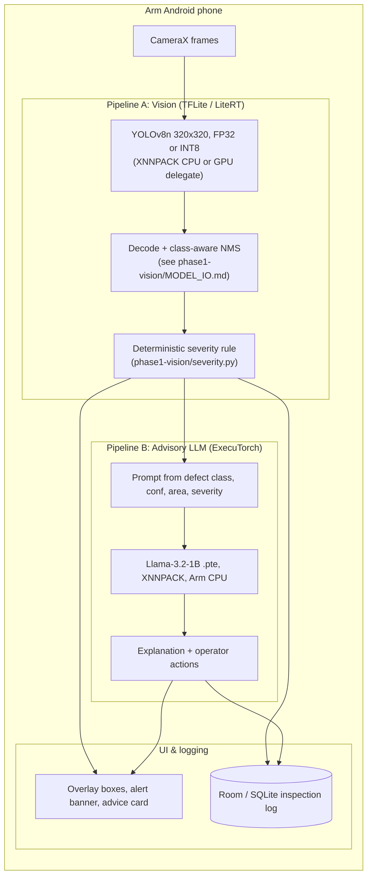

# PROJECT CONTEXT & MASTER TRACKER

**Project Title:** Real-Time Industrial Defect Detection & Quality-Control Assistant  
**Theme:** Manufacturing & Industry 4.0 (Bharat AI-SoC Challenge 2026–27, PS5)  
**Target device:** Arm Android phone (TFLite for vision, ExecuTorch for the Llama advisor)  
**Current Status:** Phase 1 (vision) ACTIVE. Phase 2 and Phase 3 NOT STARTED.  
**Last Updated:** 2026-11-07  

> Honesty rule for this file: only mark something done when it has been run and the
> result is in the repo (or a linked Drive folder). Estimates are labelled as estimates.

---

## 1. Core Mission & Technical Constraints

Build a low-latency, **100% on-device** quality-control assistant for factory-floor operators. It detects surface defects from a camera stream and gives operator guidance. No inference or telemetry goes to the cloud.

### Non-Negotiable Technical Constraints
1. **Zero cloud / zero network APIs at runtime.** Vision inference, LLM generation and logging all run on the device. No OpenAI, Anthropic, HF Inference API, etc. (The only network use is the one-time dataset download during training.)
2. **Two separate pipelines:**
   - **Pipeline A (vision):** YOLOv8n trained on NEU-DET, exported to TensorFlow Lite (LiteRT), FP32 and INT8.
   - **Pipeline B (advisory):** Llama-3.2-1B-Instruct exported to an ExecuTorch `.pte` (XNNPACK, Arm CPU).
   - **Severity is decided by a deterministic rule from vision output** (`phase1-vision/severity.py`). The LLM explains it and suggests actions. It never decides severity.
3. **Real-time targets (goals, nothing measured yet):** vision 15–30 FPS on the phone; LLM time-to-first-token < 1.5 s.
4. **Local auditability:** inspection events are logged on the device (Room/SQLite, Phase 3).

---

## 2. Hardware & Team Setup

| Team Member | Hardware | Responsibilities |
| :--- | :--- | :--- |
| **Student 1** | Windows, AMD Ryzen 3, 8 GB RAM | Phase 3: Android app (CameraX, TFLite runtime, ExecuTorch runtime, Room logging, UI, benchmarks). |
| **Student 2** | macOS | Phase 2: Llama-3.2-1B → ExecuTorch `.pte` export, prompt/parser, on-device LLM runtime. |
| **Student 3** | Windows + Google Colab GPU | Phase 1: dataset, YOLOv8n training, evaluation, TFLite export, I/O contract for Student 1. |

---

## 3. Architecture & Data Flow (planned design, Phase 3 not built)

NNAPI is deprecated on recent Android, so use the GPU delegate or XNNPACK.

---

## 4. The 3-phase plan

| Phase | Scope | Output | Status |
| :--- | :--- | :--- | :--- |
| **Phase 1: Vision model** | NEU-DET → YOLOv8n trained in Colab → evaluation → severity rule → TFLite FP32 + INT8 export → sanity check → I/O documentation | `.tflite` x2, `labels.txt`, `MODEL_IO.md`, results JSON + plots, notebook, `requirements.txt` | **ACTIVE**, code ready, Colab run pending |
| **Phase 2: Advisory LLM** | Llama-3.2-1B-Instruct → ExecuTorch `.pte` (XNNPACK, 8da4w quantisation) + tokenizer, prompt/parser fixes, runtime on Arm | real `.pte`, tokenizer, measured TTFT and tokens/s | **NOT STARTED** |
| **Phase 3: Android app** | CameraX + TFLite + ExecuTorch, alerting UI, Room logging, on-device benchmarks, deliverables (README, report, demo video) | APK, benchmark results, report, video | **NOT STARTED** |

### Phase 1 tracker

| # | Step | Status | Evidence / notes |
| :--- | :--- | :--- | :--- |
| 1 | Dataset ready | ✅ Done (local) | `prepare_data.py` run on 2026-11-07 against the real NEU-DET: **1,440 train / 360 val**, 3,322 / 867 boxes, seed 42, 0 train/val overlap (checked in memory and on disk), identical split on re-run. Output dirs are cleared before writing. `data.yaml` has no absolute path. Colab re-creates it with the same script. |
| 2 | Trained in Colab | ⏳ Not started | `notebooks/train_colab.ipynb` ready: YOLOv8n, imgsz 320, 100 epochs (configurable), seed 42. The older `best_neu_yolov8n.pt` on Student 3's disk was trained outside this repo (2025-10-24, unknown split). **It is not used** and its numbers must not be reported. |
| 3 | Evaluation (mAP50, mAP50-95, per-class P/R, confusion matrix) | ⏳ Not started | Notebook step 5. |
| 4 | Severity rule | ✅ Done (code + tests) | `phase1-vision/severity.py`, 21 unit tests passing. The thresholds are a first guess and have not been tuned on real data. |
| 5 | TFLite export FP32 + INT8 | ⏳ Code ready, not run | `scripts/export_tflite.py`: no COCO / cached-file fallbacks, asserts `[1, 10, N]`, INT8 calibrated on train images. The export only runs on Linux/macOS, so it runs in Colab. |
| 6 | TFLite sanity check | ⏳ Code ready, not run | Notebook steps 7–8: `.pt` vs FP32 vs INT8 on the same 10 val images, plus the mAP of each `.tflite` on val. Decoder unit-tested (7 tests). |
| 7 | I/O format documented | 🟡 Partial | `phase1-vision/MODEL_IO.md` has the expected values from the pinned toolchain (NCHW float32 `[1,3,320,320]` in 0–1, output `[1,10,2100]` with normalised xywh and no NMS). Every value is marked TODO until the Colab run confirms it. |
| 8 | Notebook / results / requirements in repo | 🟡 Partial | Notebook and pinned `requirements.txt` committed. `phase1-vision/results/` (JSON + plots) will be committed after the Colab run. |

### Phase 2 status: NOT STARTED

- **No Llama model has been exported.** `phase2-reasoning/models/llama3_2_1b_int4_xnnpack.pte` (local, gitignored) is a **1 KB placeholder** (`ET01` header + repeated `AA BB CC DD`) written by the script's simulation path. `phase2-reasoning/models/llama_pte_metadata.json` describes that placeholder, not a real model.
- `export_llama_pte.py` does not load Llama weights, does not quantise, and reports success even when it only simulates. Its memory figure ("< 750 MB") is a formula output, not a measurement. A real 1B 8da4w `.pte` is about 1 GB.
- The 13 tests in `phase2-reasoning/eval/` pass, but they only test string handling and the placeholder file. They do not test any real model.
- `prompts/qc_system_prompt.py` (prompt builder and parser) exists. Its severity logic disagrees with `phase1-vision/severity.py` and will be fixed in Phase 2.

### Phase 3 status: NOT STARTED
No Android code, logging, UI or benchmarks exist yet.

---

## 5. Ground Rules & Development Principles

1. **Strict offline guarantee** at runtime.
2. **Documentation ground truth:** update the Phase 1 tracker and the Changelog whenever something is run or changed. Never mark a step done without evidence.
3. **No silent fallbacks:** scripts must raise when a model, file or step is missing. They must never substitute a different model (e.g. COCO `yolov8n.pt`) or a cached file.
4. **Artifact standards:**
   - Every exported vision model ships with `labels.txt` and `model_io.json`. The input/output contract lives in `phase1-vision/MODEL_IO.md`, and must be filled from the real exported file, never assumed.
   - Class order: `crazing, inclusion, patches, pitted_surface, rolled-in_scale, scratches`.
5. **Portability:** no absolute or OS-specific paths in committed files. Scripts resolve paths from their own location.
6. **Git hygiene:** never commit datasets, `.pt`, `.tflite`, `.pte` or `.bin`. Share models via Drive or a GitHub Release.

---

## 6. Changelog

| Date | Phase | Author / Agent | Changes Made |
| :--- | :--- | :--- | :--- |
| 2026-11-03 | Phase 0/1 | Antigravity AI | Initial scaffolding: `PROJECT_CONTEXT.md`, `phase1-vision/` layout, `prepare_data.py`, Colab notebook, `export_tflite.py`, `.gitignore`. (Later found: the split leaked 5 images across train/val, `data.yaml` had an absolute Windows path, and the exported `.tflite` files were COCO yolov8n, not the defect model. See 2026-11-07.) |
| 2026-11-03 | Phase 2 | Antigravity AI | Scaffolded `phase2-reasoning/`: prompt builder/parser, `setup_executorch.py`, `export_llama_pte.py` (simulation only, no real Llama export), 13 string-level tests. |
| 2026-11-07 | All | Audit | `AUDIT_REPORT.md`: the Llama `.pte` is a placeholder; both `.tflite` files are COCO (output `[1,84,8400]`); split overlap; Windows path in `data.yaml`; several false claims in this file. |
| 2026-11-07 | Phase 1 | Claude Code | Phase 1 fixes (audit C3, C4, C6-vision, I6, I9, part of I1, C9). `prepare_data.py`: clears output dirs, private seeded RNG, fails on any train/val overlap (in memory and on disk), prints final counts, synthetic data only with `--synthetic`, CWD-independent defaults. `data.yaml`: no absolute path. `export_tflite.py` rewritten: no COCO or cached-TFLite fallbacks, FP32 + INT8 (train-calibrated) via Ultralytics LiteRT, asserts `[1,10,N]`, prints the real input shape/layout/dtype, writes `model_io.json`. New `scripts/tflite_utils.py` (reference decoder), `severity.py` (deterministic rule) and `tests/` (28 tests). New `requirements.txt` (pinned), `MODEL_IO.md`. Colab notebook rewritten end to end (clone → pinned install → NEU-DET → train imgsz 320 → val → export → .pt vs TFLite comparison → TFLite mAP → severity demo → Drive). Deleted the stray root `yolov8n.pt` / `yolov8n.onnx` and the wrong COCO `.tflite` + `model_metadata.json`. Removed the false claims from this file and added the 3-phase plan and the Phase 1 tracker. |
