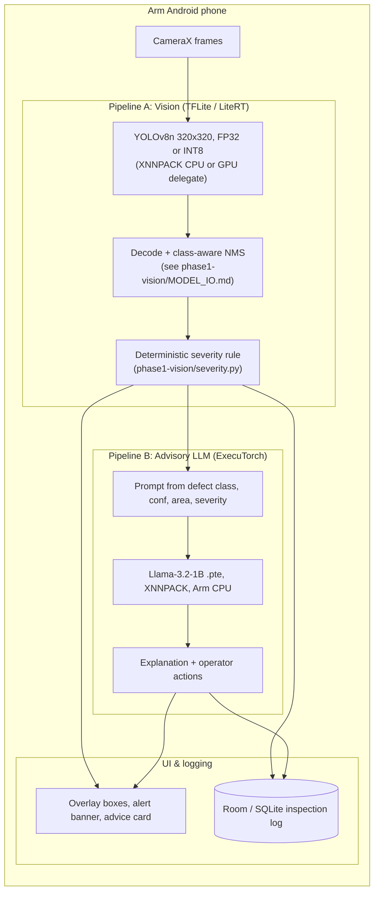

# PROJECT CONTEXT & MASTER TRACKER

**Project Title:** Real-Time Industrial Defect Detection & Quality-Control Assistant  
**Theme:** Manufacturing & Industry 4.0 (Bharat AI-SoC Challenge 2026–27, PS5)  
**Target device:** Arm Android phone (TFLite for vision, ExecuTorch for the Llama advisor)  
**Current Status:** Phase 1 (vision) COMPLETE. Phase 2 (advisory LLM) NEXT. Phase 3 NOT STARTED.  
**Last Updated:** 2026-11-07  

> Honesty rule for this file: only mark something done when it has been run and the
> result is in the repo (or a linked Drive folder). Estimates are labelled as estimates.

---

## 1. Core Mission & Technical Constraints

Build a low-latency, **100% on-device** quality-control assistant for factory-floor operators. It detects surface defects from a camera stream and gives operator guidance. No inference or telemetry goes to the cloud.

### Non-Negotiable Technical Constraints
1. **Zero cloud / zero network APIs at runtime.** Vision inference, LLM generation and logging all run on the device. No OpenAI, Anthropic, HF Inference API, etc. (The only network use is the one-time dataset download during training.)
2. **Two separate pipelines:**
   - **Pipeline A (vision):** YOLOv8n trained on NEU-DET, exported to TensorFlow Lite (LiteRT), FP32 and INT8.
   - **Pipeline B (advisory):** Llama-3.2-1B-Instruct exported to an ExecuTorch `.pte` (XNNPACK, Arm CPU).
   - **Severity is decided by a deterministic rule from vision output** (`phase1-vision/severity.py`). The LLM explains it and suggests actions. It never decides severity.
3. **Real-time targets (goals, nothing measured yet):** vision 15–30 FPS on the phone; LLM time-to-first-token < 1.5 s.
4. **Local auditability:** inspection events are logged on the device (Room/SQLite, Phase 3).

---

## 2. Hardware & Team Setup

| Team Member | Hardware | Responsibilities |
| :--- | :--- | :--- |
| **Student 1** | Windows, AMD Ryzen 3, 8 GB RAM | Phase 3: Android app (CameraX, TFLite runtime, ExecuTorch runtime, Room logging, UI, benchmarks). |
| **Student 2** | macOS | Phase 2: Llama-3.2-1B → ExecuTorch `.pte` export, prompt/parser, on-device LLM runtime. |
| **Student 3** | Windows + Google Colab GPU | Phase 1: dataset, YOLOv8n training, evaluation, TFLite export, I/O contract for Student 1. |

---

## 3. Architecture & Data Flow (planned design, Phase 3 not built)

NNAPI is deprecated on recent Android, so use the GPU delegate or XNNPACK.

---

## 4. The 3-phase plan

| Phase | Scope | Output | Status |
| :--- | :--- | :--- | :--- |
| **Phase 1: Vision model** | NEU-DET → YOLOv8n trained in Colab → evaluation → severity rule → TFLite FP32 + INT8 export → sanity check → I/O documentation | `.tflite` x2, `labels.txt`, `MODEL_IO.md`, results JSON + plots, notebook, `requirements.txt` | **COMPLETE** (2026-11-07) |
| **Phase 2: Advisory LLM** | Llama-3.2-1B-Instruct → ExecuTorch `.pte` (XNNPACK, 8da4w quantisation) + tokenizer, prompt/parser fixes, runtime on Arm | real `.pte`, tokenizer, measured TTFT and tokens/s | **NEXT** (not started) |
| **Phase 3: Android app** | CameraX + TFLite + ExecuTorch, alerting UI, Room logging, on-device benchmarks, deliverables (README, report, demo video) | APK, benchmark results, report, video | **NOT STARTED** |

### Phase 1 tracker (COMPLETE, 2026-11-07)

Source of every number: `phase1-vision/results/phase1_results.json` from the Colab run of commit `25551ad`
(Tesla T4, Ultralytics 8.4.198, torch 2.14.1, Python 3.13). Run name `neu_yolov8n_320_e100_s42`.
**Models are on Google Drive under `MyDrive/qc-defect-detector/phase1/neu_yolov8n_320_e100_s42/models/`, not in git**
(`best.pt`, `defect_yolov8n_320_{fp32,int8}.tflite`, `labels.txt`, `model_io.json`).

| # | Step | Status | Evidence / notes |
| :--- | :--- | :--- | :--- |
| 1 | Dataset ready | ✅ Done | Real NEU-DET, `prepare_data.py` seed 42: **1,440 train / 360 val**, 0 train/val overlap (checked in memory and on disk, also in Colab). `data.yaml` has no absolute path. |
| 2 | Trained in Colab | ✅ Done | YOLOv8n from COCO-pretrained weights, imgsz 320, batch 32, seed 42, **100/100 epochs** (patience 30), **15.6 min** on a T4. Curves: `results/results.png`, `results/results.csv`. |
| 3 | Evaluation | ✅ Done | `best.pt` on val: **mAP50 0.769, mAP50-95 0.446**, P 0.714, R 0.736 (Ultralytics default val = 352 px input; **at the deployed 320 px input: 0.744 / 0.420**, see step 6). Per-class mAP50: crazing **0.406**, inclusion 0.856, patches 0.925, pitted_surface 0.850, rolled-in_scale **0.652**, scratches 0.927. **Weak classes: crazing** (R 0.34, mAP50-95 0.149) and **rolled-in_scale** (mAP50-95 0.307). Confusion matrices and PR/P/R/F1 curves in `results/`. |
| 4 | Severity rule | ✅ Done | `phase1-vision/severity.py`, 30 unit tests passing. Per-class min confidence: **crazing 0.25**, all others 0.50. Chosen from the 360-image val sweep (`results/phase1_checks.json` -> `pr_sweep`): crazing images flagged FP32 56/60, INT8 51/60 (vs 25/60, 21/60 at 0.50); box precision at 0.25 (FP32 0.42, INT8 0.49) is no worse than at 0.30; 0 crazing detections on the 300 non-crazing images at any threshold down to 0.10. 0.30 was rejected because INT8 scores `crazing_90.jpg` at 0.299. **Area thresholds tuned from data:** `scripts/tune_severity.py` takes the 866 val ground-truth boxes and sets Low/Medium/High cutoffs at their p40/p70/p90 area ratio: **0.082 / 0.184 / 0.359** (was 0.02 / 0.05 / 0.10, a guess under which 8 of 10 demo images were Critical). GT boxes then split 40 / 30 / 20 / 10 %. Per class it is uneven (pitted_surface boxes are big: 73 % Critical; inclusion small: 75 % Low) because the rule is class-neutral. On all 360 val images (conf 0.25 detections) the FP32 detection levels are Low 41.8 / Medium 30.1 / High 17.3 / Critical 10.7 %; image levels (worst detection, then the 3+ escalation) are **FP32: Low 31, Medium 98, High 90, Critical 116, none 25** (90 escalated); **INT8: 33 / 89 / 92 / 115, none 31**. Image levels lean to High/Critical because one image takes its worst box and many NEU images have 3+ defects. `results/severity_demo.png` regenerated (FP32 + INT8). **Tuned on NEU 200x200 crops: must be re-tuned on real camera images in Phase 3.** The Phase 2 prompt (`qc_system_prompt.py`) still has the old 0.02 / 0.10 numbers. |
| 5 | TFLite export FP32 + INT8 | ✅ Done | `export_tflite.py` in Colab. **FP32 12.69 MB, INT8 3.44 MB** (INT8 calibrated on 30 % of train, float32 I/O). Both asserted `[1, 10, 2100]`. |
| 6 | TFLite sanity check | ✅ Done | Val mAP50 / mAP50-95 at 320 px: **`.pt` 0.744 / 0.420 = FP32 0.744 / 0.420**, INT8 0.715 / 0.372 locally (0.707 / 0.367 in Colab; quantised kernels differ by CPU). **The `.pt` -> FP32 gap was the val input size** (352 px rect for `.pt`, fixed 320 for TFLite), not conversion loss. Full val (360 images, conf 0.25) vs `.pt`: **FP32 949/949 detections matched (100 %), 360/360 images identical; INT8 868/949 (91.5 %), 268/360 images identical**, mean IoU 0.907. **Image-level accuracy** (>= 1 kept detection of the image's class): **FP32 334/360 = 92.8 %, INT8 327/360 = 90.8 %**; per class FP32 / INT8: crazing 93 / 85 %, inclusion 100 / 98 %, patches 100 / 100 %, pitted_surface 92 / 88 %, rolled-in_scale 73 / 75 %, scratches 98 / 98 %. Misses are nearly all "no detection kept" (FP32 25, INT8 31), only 1 / 2 wrong-class. Source: `scripts/check_models.py` -> `results/phase1_checks.json`. |
| 7 | I/O format documented | ✅ Done | `phase1-vision/MODEL_IO.md`, all values confirmed on the exported files, plus SHA-256 of every model file: input NCHW float32 `[1,3,320,320]` in 0–1, output float32 `[1,10,2100]`, boxes normalised xywh (max abs 1.01), sigmoid class scores, no NMS. |
| 8 | Notebook / results / requirements in repo | ✅ Done | Notebook, pinned `requirements.txt`, and `phase1-vision/results/` (JSON, CSV, PNGs; no model files) committed. |

### Phase 2 status: NEXT (not started)

- **No Llama model has been exported.** `phase2-reasoning/models/llama3_2_1b_int4_xnnpack.pte` (local, gitignored) is a **1 KB placeholder** (`ET01` header + repeated `AA BB CC DD`) written by the script's simulation path. `phase2-reasoning/models/llama_pte_metadata.json` describes that placeholder, not a real model.
- `export_llama_pte.py` does not load Llama weights, does not quantise, and reports success even when it only simulates. Its memory figure ("< 750 MB") is a formula output, not a measurement. A real 1B 8da4w `.pte` is about 1 GB.
- The 13 tests in `phase2-reasoning/eval/` pass, but they only test string handling and the placeholder file. They do not test any real model.
- `prompts/qc_system_prompt.py` (prompt builder and parser) exists. Its severity logic disagrees with `phase1-vision/severity.py` and will be fixed in Phase 2.

### Phase 3 status: NOT STARTED
No Android code, logging, UI or benchmarks exist yet.

---

## 5. Ground Rules & Development Principles

1. **Strict offline guarantee** at runtime.
2. **Documentation ground truth:** update the Phase 1 tracker and the Changelog whenever something is run or changed. Never mark a step done without evidence.
3. **No silent fallbacks:** scripts must raise when a model, file or step is missing. They must never substitute a different model (e.g. COCO `yolov8n.pt`) or a cached file.
4. **Artifact standards:**
   - Every exported vision model ships with `labels.txt` and `model_io.json`. The input/output contract lives in `phase1-vision/MODEL_IO.md`, and must be filled from the real exported file, never assumed.
   - Class order: `crazing, inclusion, patches, pitted_surface, rolled-in_scale, scratches`.
5. **Portability:** no absolute or OS-specific paths in committed files. Scripts resolve paths from their own location.
6. **Git hygiene:** never commit datasets, `.pt`, `.tflite`, `.pte` or `.bin`. Share models via Drive or a GitHub Release.

---

## 6. Changelog

| Date | Phase | Author / Agent | Changes Made |
| :--- | :--- | :--- | :--- |
| 2026-11-03 | Phase 0/1 | Antigravity AI | Initial scaffolding: `PROJECT_CONTEXT.md`, `phase1-vision/` layout, `prepare_data.py`, Colab notebook, `export_tflite.py`, `.gitignore`. (Later found: the split leaked 5 images across train/val, `data.yaml` had an absolute Windows path, and the exported `.tflite` files were COCO yolov8n, not the defect model. See 2026-11-07.) |
| 2026-11-03 | Phase 2 | Antigravity AI | Scaffolded `phase2-reasoning/`: prompt builder/parser, `setup_executorch.py`, `export_llama_pte.py` (simulation only, no real Llama export), 13 string-level tests. |
| 2026-11-07 | All | Audit | `AUDIT_REPORT.md`: the Llama `.pte` is a placeholder; both `.tflite` files are COCO (output `[1,84,8400]`); split overlap; Windows path in `data.yaml`; several false claims in this file. |
| 2026-11-07 | Phase 1 | Claude Code | Phase 1 fixes (audit C3, C4, C6-vision, I6, I9, part of I1, C9). `prepare_data.py`: clears output dirs, private seeded RNG, fails on any train/val overlap (in memory and on disk), prints final counts, synthetic data only with `--synthetic`, CWD-independent defaults. `data.yaml`: no absolute path. `export_tflite.py` rewritten: no COCO or cached-TFLite fallbacks, FP32 + INT8 (train-calibrated) via Ultralytics LiteRT, asserts `[1,10,N]`, prints the real input shape/layout/dtype, writes `model_io.json`. New `scripts/tflite_utils.py` (reference decoder), `severity.py` (deterministic rule) and `tests/` (28 tests). New `requirements.txt` (pinned), `MODEL_IO.md`. Colab notebook rewritten end to end (clone → pinned install → NEU-DET → train imgsz 320 → val → export → .pt vs TFLite comparison → TFLite mAP → severity demo → Drive). Deleted the stray root `yolov8n.pt` / `yolov8n.onnx` and the wrong COCO `.tflite` + `model_metadata.json`. Removed the false claims from this file and added the 3-phase plan and the Phase 1 tracker. |
| 2026-11-07 | Phase 1 | Claude Code | **Phase 1 complete.** Colab run of `25551ad` (T4, 100 epochs, 15.6 min): `best.pt` val mAP50 0.769 / mAP50-95 0.446; FP32 TFLite 0.744 / 0.420 (12.69 MB); INT8 TFLite 0.707 / 0.367 (3.44 MB); 10-image match vs `.pt` 100 % (FP32) / 92 % (INT8). Weak classes: crazing, rolled-in_scale. `MODEL_IO.md` filled with the confirmed values (NCHW float32 input, `[1,10,2100]` output, normalised boxes). `severity.py`: per-class min confidence (crazing 0.30, others 0.50), 7 new tests (35 total pass). Committed `phase1-vision/results/` (JSON, CSV, PNGs). Models stay on Google Drive. |
| 2026-11-07 | Phase 1 | Claude Code | Post-run checks with the Drive models (new `scripts/check_models.py`, runs on Windows CPU; output `results/phase1_checks.json`). SHA-256 of all 5 model files in `MODEL_IO.md`. Full-val `.pt` vs TFLite: FP32 100 % (949/949), INT8 91.5 % (868/949). `.pt` -> FP32 mAP gap explained: Ultralytics evaluates `.pt` at 352 px (rect), TFLite at 320; at 320 the `.pt` equals FP32 (0.744 / 0.420). Crazing min confidence 0.30 -> **0.25** from the P/R sweep (0.30 dropped `crazing_90.jpg` on INT8). `severity_demo.png` regenerated with the current rule for FP32 and INT8. 36 tests pass. `.gitignore`: Ultralytics label cache. |
| 2026-11-07 | Phase 1 | Claude Code | Severity area thresholds tuned from data: new `scripts/tune_severity.py` (p40/p70/p90 of the 866 val GT box area ratios -> `results/severity_thresholds.json`): 0.02 / 0.05 / 0.10 -> **0.082 / 0.184 / 0.359**. Tests updated (37 pass). `check_models.py` now also reports the severity level distribution and image-level accuracy on all 360 val images (FP32 92.8 %, INT8 90.8 %); `severity_demo.png` regenerated. Tuned on NEU crops only: re-tune on camera images in Phase 3. |
